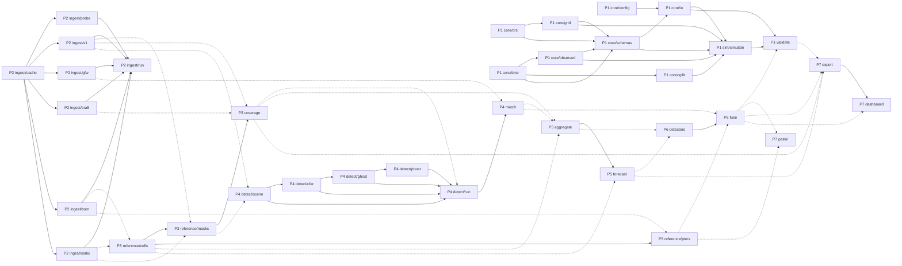

# Issue plan: build order, priority, dependencies

**Solid arrow / Blocked by** = cannot start until done. **Dashed / Needs real output from** = start on the simulator, switch to real data when it lands.

## Wave 1

- **`P1 core/crs`** Implement core/crs · 🔴 critical · M1
- **`P1 core/time`** Implement core/time · 🔴 critical · M1
- **`P1 core/config`** Implement core/config · 🔴 critical · M1

## Wave 2

- **`P1 core/grid`** Implement core/grid · 🔴 critical · M1
  - Blocked by: `P1 core/crs`
- **`P1 core/observed`** Implement core/observed · 🔴 critical · M1
  - Blocked by: `P1 core/time`
- **`P1 core/split`** Implement core/split · 🔴 critical · M1
  - Blocked by: `P1 core/time`

## Wave 3

- **`P1 core/schemas`** Implement core/schemas · 🔴 critical · M1
  - Blocked by: `P1 core/crs`, `P1 core/grid`, `P1 core/observed`, `P1 core/time`

## Wave 4

- **`P1 stubs`** Stubs for every public function · 🔴 critical · M1
  - Blocked by: `P1 core/schemas`
- **`P1 core/io`** Implement core/io · 🔴 critical · M1
  - Blocked by: `P1 core/schemas`, `P1 core/config`

## Wave 5

- **`P1 sim/simulate`** Implement sim/simulate · 🔴 critical · M1
  - Blocked by: `P1 core/grid`, `P1 core/observed`, `P1 core/schemas`, `P1 core/io`, `P1 core/split`

## Wave 6

- **`P1 validate`** Implement validate · 🟠 high · M3
  - Blocked by: `P1 sim/simulate`, `P1 core/io`
  - Needs real output from: `P6 fuse`
- **`P2 stubs`** Stubs for every public function · 🔴 critical · M1
  - Blocked by: `P1 core/schemas`, `P1 sim/simulate`
- **`P3 stubs`** Stubs for every public function · 🔴 critical · M1
  - Blocked by: `P1 core/schemas`, `P1 sim/simulate`
- **`P4 stubs`** Stubs for every public function · 🔴 critical · M1
  - Blocked by: `P1 core/schemas`, `P1 sim/simulate`
- **`P5 stubs`** Stubs for every public function · 🔴 critical · M1
  - Blocked by: `P1 core/schemas`, `P1 sim/simulate`
- **`P6 stubs`** Stubs for every public function · 🔴 critical · M1
  - Blocked by: `P1 core/schemas`, `P1 sim/simulate`
- **`P7 stubs`** Stubs for every public function · 🔴 critical · M1
  - Blocked by: `P1 core/schemas`, `P1 sim/simulate`

## Wave 7

- **`P2 ingest/cache`** Implement ingest/cache · 🔴 critical · M2
  - Blocked by: `P2 stubs`
- **`P3 reference/cells`** Implement reference/cells · 🔴 critical · M2
  - Blocked by: `P3 stubs`
  - Needs real output from: `P2 ingest/static`, `P2 ingest/osm`
- **`P4 detect/scene`** Implement detect/scene · 🔴 critical · M3
  - Blocked by: `P4 stubs`
  - Needs real output from: `P2 ingest/s1`, `P3 reference/masks`
- **`P5 aggregate`** Implement aggregate · 🔴 critical · M3
  - Blocked by: `P5 stubs`
  - Needs real output from: `P4 match`, `P3 coverage`, `P3 reference/cells`
- **`P6 detectors`** Implement detectors · 🔴 critical · M3
  - Blocked by: `P6 stubs`
  - Needs real output from: `P5 aggregate`, `P5 forecast`
- **`P7 patrol`** Implement patrol · 🟠 high · M3
  - Blocked by: `P7 stubs`
  - Needs real output from: `P6 fuse`, `P3 reference/piers`
- **`P7 export`** Implement export · 🔴 critical · M3
  - Blocked by: `P7 stubs`
  - Needs real output from: `P6 fuse`, `P5 forecast`, `P3 coverage`, `P1 validate`

## Wave 8

- **`P2 ingest/probe`** Implement ingest/probe · 🔴 critical · M2
  - Blocked by: `P2 stubs`, `P2 ingest/cache`
- **`P2 ingest/s1`** Implement ingest/s1 · 🔴 critical · M2
  - Blocked by: `P2 stubs`, `P2 ingest/cache`
- **`P2 ingest/gfw`** Implement ingest/gfw · 🔴 critical · M2
  - Blocked by: `P2 stubs`, `P2 ingest/cache`
- **`P2 ingest/era5`** Implement ingest/era5 · 🟠 high · M2
  - Blocked by: `P2 stubs`, `P2 ingest/cache`
- **`P2 ingest/osm`** Implement ingest/osm · 🟠 high · M2
  - Blocked by: `P2 stubs`, `P2 ingest/cache`
- **`P2 ingest/static`** Implement ingest/static · 🔴 critical · M2
  - Blocked by: `P2 stubs`, `P2 ingest/cache`
- **`P3 reference/masks`** Implement reference/masks · 🔴 critical · M2
  - Blocked by: `P3 stubs`, `P3 reference/cells`
  - Needs real output from: `P2 ingest/static`, `P2 ingest/s1`
- **`P3 reference/piers`** Implement reference/piers · 🟠 high · M2
  - Blocked by: `P3 stubs`, `P3 reference/cells`
  - Needs real output from: `P2 ingest/osm`
- **`P4 detect/cfar`** Implement detect/cfar · 🔴 critical · M3
  - Blocked by: `P4 stubs`, `P4 detect/scene`
- **`P5 forecast`** Implement forecast · 🔴 critical · M3
  - Blocked by: `P5 stubs`, `P5 aggregate`
  - Needs real output from: `P3 reference/cells`
- **`P6 fuse`** Implement fuse · 🔴 critical · M3
  - Blocked by: `P6 stubs`, `P6 detectors`
  - Needs real output from: `P3 reference/piers`, `P4 match`
- **`P7 dashboard`** Implement dashboard · 🔴 critical · M3
  - Blocked by: `P7 stubs`, `P7 export`
  - Needs real output from: `P6 fuse`

## Wave 9

- **`P2 ingest/run`** Implement ingest/run · 🔴 critical · M2
  - Blocked by: `P2 stubs`, `P2 ingest/probe`, `P2 ingest/s1`, `P2 ingest/gfw`, `P2 ingest/era5`, `P2 ingest/osm`, `P2 ingest/static`
- **`P3 coverage`** Implement coverage · 🔴 critical · M2
  - Blocked by: `P3 stubs`, `P3 reference/masks`
  - Needs real output from: `P2 ingest/era5`, `P2 ingest/s1`
- **`P4 detect/ghost`** Implement detect/ghost · 🔴 critical · M3
  - Blocked by: `P4 stubs`, `P4 detect/cfar`

## Wave 10

- **`P4 detect/pboat`** Implement detect/pboat · 🔴 critical · M3
  - Blocked by: `P4 stubs`, `P4 detect/ghost`

## Wave 11

- **`P4 detect/run`** Implement detect/run · 🔴 critical · M3
  - Blocked by: `P4 stubs`, `P4 detect/scene`, `P4 detect/cfar`, `P4 detect/ghost`, `P4 detect/pboat`
  - Needs real output from: `P3 coverage`

## Wave 12

- **`P4 match`** Implement match · 🔴 critical · M3
  - Blocked by: `P4 stubs`, `P4 detect/run`
  - Needs real output from: `P2 ingest/gfw`

## Dependency graph

